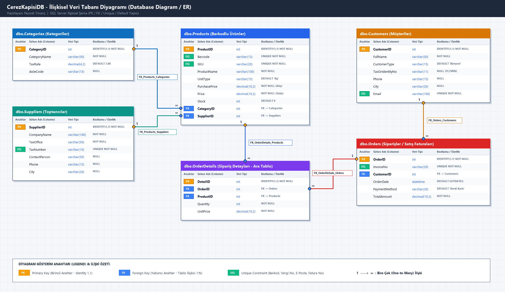
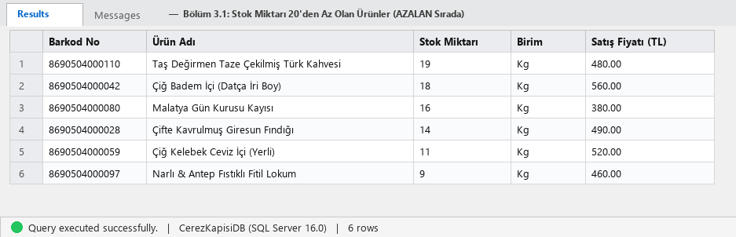
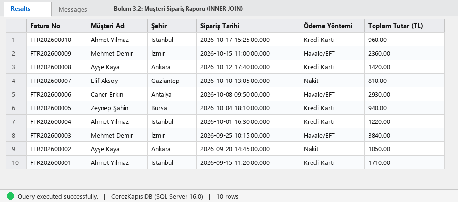
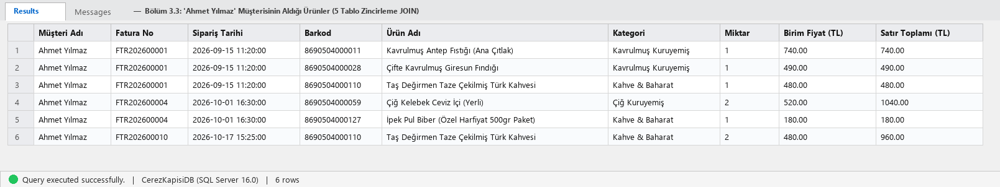
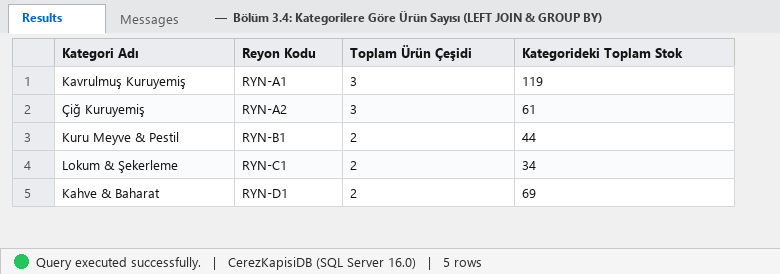
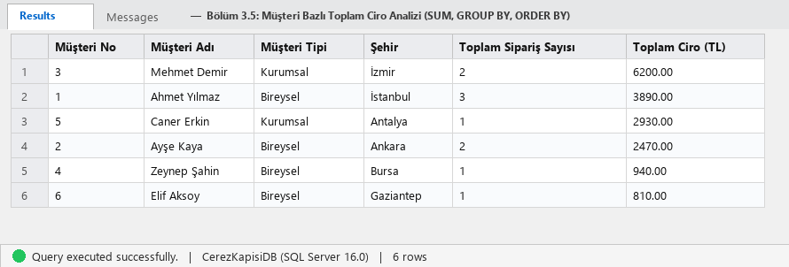
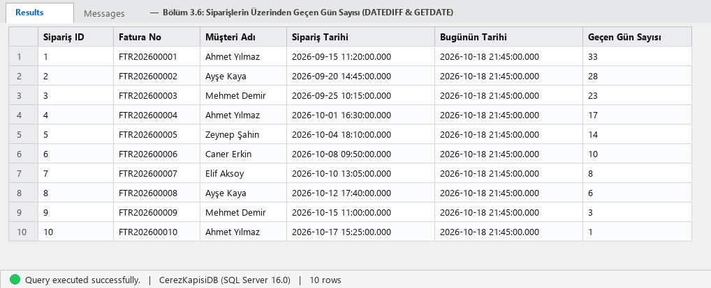
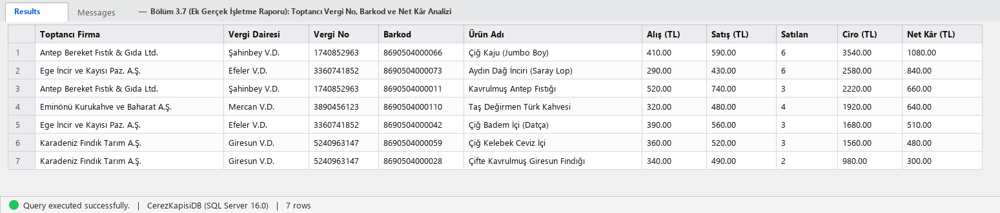
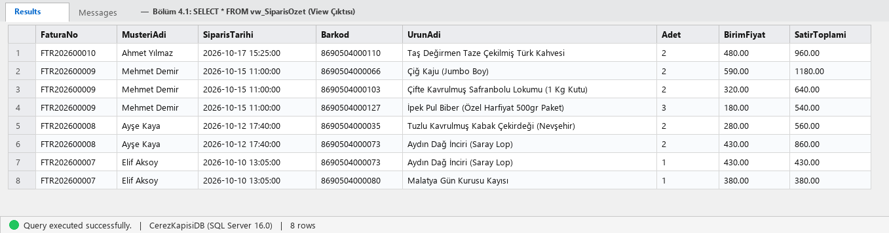

<div align="center">

# 🥜 ÇerezKapısı — Barkodlu Kuruyemiş Satış, Stok ve Toptancı Veri Yönetim Sistemi (`CerezKapisiDB`)

[](./NusretYinanc_CerezKapisi_Proje.sql)
[-2563EB?style=for-the-badge)](./NusretYinanc_CerezKapisi_Proje.png)
[](./src/app.js)
[](./NusretYinanc_CerezKapisi_Proje.docx)

**Gerçek bir kuruyemiş ve gurme gıda işletmesinin barkodlu ürün envanterini, toptancı vergi kayıtlarını, alış/satış maliyet marjlarını ve faturalı müşteri siparişlerini yöneten uçtan uca İlişkisel Veri Tabanı (SQL) ve ERP Raporlama Projesi.**

[📄 Tek Parça SQL Betiği (`.sql`)](./NusretYinanc_CerezKapisi_Proje.sql) • [📘 Word Proje Raporu (`.docx`)](./NusretYinanc_CerezKapisi_Proje.docx) • [🖼️ İlişkisel ER Diyagramı (`.png`)](./NusretYinanc_CerezKapisi_Proje.png) • [💻 Canlı ERP Web Paneli (`src/`)](./src/public/index.html)

</div>

---

## 📑 İçindekiler
1. [Projenin Amacı ve İşletme Senaryosu](#-1-projenin-amacı-ve-işletme-senaryosu)
2. [Proje Klasör ve Dosya Mimarisi](#-2-proje-klasör-ve-dosya-mimarisi)
3. [BÖLÜM 1: Veri Tabanı Tasarımı, ER Diyagramı ve Veri Sözlüğü (DDL)](#-3-bölüm-1-veri-tabanı-tasarımı-er-diyagramı-ve-veri-sözlüğü-ddl)
4. [BÖLÜM 2: Örnek Veri Girişi Özeti (DML - Insert)](#-4-bölüm-2-örnek-veri-girişi-özeti-dml---insert)
5. [BÖLÜM 3: Yönetim Kurulu Sorguları, SSMS Çıktıları ve Analizler (DQL)](#-5-bölüm-3-yönetim-kurulu-sorguları-ssms-çıktıları-ve-analizler-dql)
6. [BÖLÜM 4: İleri Seviye Veri Tabanı Nesneleri (`VIEW` ve `BACKUP`)](#-6-bölüm-4-ileri-seviye-veri-tabanı-nesneleri-view-ve-backup)
7. [Canlı ERP & SQL Yönetim Panelini Çalıştırma](#-7-canlı-erp--sql-yönetim-panelini-çalıştırma)

---

## 🎯 1. Projenin Amacı ve İşletme Senaryosu

Bu proje; veri tabanı tasarımı (**Logical Design & DDL**), tablo oluşturma, anahtar kısıtlamaları (**Primary Key, Foreign Key, Unique, Default, Identity**), veri manipülasyonu (**DML**) ve ileri düzey analitik sorgulama (**JOIN, LEFT JOIN, GROUP BY, SUM, COUNT, DATEDIFF, VIEW, BACKUP**) yetkinliklerini gerçek bir ticari işletme senaryosu üzerinde uygulamak amacıyla geliştirilmiştir.

### 🏢 İşletme Senaryosu: Neden Standart Bir Tablo Yapısından Fazlası?
Yeni kurulan **"ÇerezKapısı"** kuruyemiş ve gurme gıda mağazasında veri tabanı yöneticisi (DBA) olarak görevlendirildiniz. Gerçek bir perakende/toptan işletmesinde yalnızca ürün adı ve satış fiyatı tutmak yeterli değildir. Bu nedenle **`CerezKapisiDB`** şeması gerçek piyasa standartlarına göre şu ticari detaylarla donatılmıştır:
* **Barkodlu Stok Takibi (`EAN-13 Barcode` & `SKU`):** Kasada barkod okuyucu ile yapılan satışlarda her ürün benzersiz 13 haneli barkod (`869...`) ve stok takip kodu (`CRZ-...`) ile tanımlanır.
* **Toptancı ve Vergi Numarası Kayıtları (`Suppliers`):** Ürünlerin hangi toptancıdan alındığı, toptancının bağlı olduğu **Vergi Dairesi (`TaxOffice`)** ve **10 Haneli Vergi Kimlik Numarası (`TaxNumber - UNIQUE`)** kayıt altında tutulur.
* **Alış Maliyeti ve Net Kâr Hesabı (`PurchasePrice` vs `Price`):** Ürünün toptancıdan geliş maliyeti (`PurchasePrice`) ile müşteriye perakende satış fiyatı (`Price`) ayrı tutularak her satış kaleminden elde edilen **Net Kâr** doğrudan SQL ile hesaplanır.
* **Faturalı Sipariş ve Tarihsel Fiyat Bütünlüğü (`Orders` & `OrderDetails`):** Her siparişe benzersiz bir fatura numarası (`FTR2026...`) atanır ve ürünün gelecekteki fiyat değişimlerinden geçmiş faturaların etkilenmemesi için satış anındaki birim fiyat (`UnitPrice`) `OrderDetails` tablosuna kaydedilir.

---

## 📂 2. Proje Klasör ve Dosya Mimarisi

```text
cerezkapisi-sql-proje/
│
├── 📄 NusretYinanc_CerezKapisi_Proje.sql        # [TESLİM 1] Tüm adımları ve yorumları içeren tek parça T-SQL betiği
├── 📘 NusretYinanc_CerezKapisi_Proje.docx       # [TESLİM 2] Kod kutulu, SSMS ekran görüntülü ve açıklamalı Word raporu
├── 🖼️ NusretYinanc_CerezKapisi_Proje.png        # [TESLİM 3] Tabloların ilişkisel yapısını gösteren ER Diyagramı
│
├── 📁 sql/                                      # Aşamalara Göre Ayrılmış Modüler SQL Betikleri
│   ├── 01_ddl_tablolar.sql                      # Bölüm 1: Veri Tabanı ve Tablo Oluşturma (DDL)
│   ├── 02_dml_veriler.sql                       # Bölüm 2: Örnek Veri Girişi (DML - Insert)
│   ├── 03_dql_sorgular.sql                      # Bölüm 3: Sorgulama ve Analiz Raporları (DQL)
│   └── 04_view_ve_backup.sql                    # Bölüm 4: View (vw_SiparisOzet) ve Yedekleme (Backup)
│
├── 📁 rapor_gorselleri/                         # Sorguların SSMS Sonuç Tablosu Ekran Görüntüleri
│   ├── q1_temel_listeleme.png                   # Sorgu 1: Kritik Stok (< 20) Çıktısı
│   ├── q2_musteri_siparis_join.png              # Sorgu 2: Müşteri Siparişleri (INNER JOIN) Çıktısı
│   ├── q3_coklu_join_ahmet.png                  # Sorgu 3: Ahmet Yılmaz Detay Raporu (5'li JOIN) Çıktısı
│   ├── q4_kategori_gruplama.png                 # Sorgu 4: Kategori Ürün Sayıları (LEFT JOIN & GROUP BY) Çıktısı
│   ├── q5_ciro_analizi.png                      # Sorgu 5: Müşteri Bazlı Ciro Analizi (SUM & GROUP BY) Çıktısı
│   ├── q6_zaman_analizi.png                     # Sorgu 6: Sipariş Zaman Analizi (DATEDIFF & GETDATE) Çıktısı
│   ├── q7_toptanci_kar.png                      # Sorgu 7: Toptancı Vergi No & Net Kâr Analizi Çıktısı
│   └── q8_view_siparis_ozet.png                 # Bölüm 4: vw_SiparisOzet View Çıktısı
│
├── 📁 src/                                      # Canlı Çalışan ERP & SQL Raporlama Web Uygulaması
│   ├── app.js                                   # Node.js HTTP Sunucusu ve API Yönlendiricisi (Sıfır Bağımlılık)
│   ├── database/db.js                           # İlişkisel SQL Veri Tabanı ve Otomatik Seed Motoru
│   ├── controllers/erpController.js             # Raporlama, Barkodlu Stok, Fatura Transaction ve Backup İşlemleri
│   └── public/index.html                        # 5 Sekmeli İnteraktif ERP & DBA Yönetim Arayüzü
│
├── 📁 data/
│   └── CerezKapisiDB.sqlite                     # Canlı Uygulama Veri Tabanı Dosyası
└── package.json
```

---

## 📐 3. BÖLÜM 1: Veri Tabanı Tasarımı, ER Diyagramı ve Veri Sözlüğü (DDL)

Yabancı Anahtar (**Foreign Key**) bağımlılık kurallarına uygun olarak önce ana tablolar (`Categories`, `Suppliers`, `Customers`), ardından bağımlı tablolar (`Products`, `Orders`, `OrderDetails`) oluşturulmuştur.

### İlişkisel Veri Tabanı Şeması (ER Diagram)


### Veri Sözlüğü (Data Dictionary)

#### A. `dbo.Categories` (Kategoriler)
| Sütun Adı | Veri Tipi | Kısıtlamalar | Açıklama |
| :--- | :--- | :--- | :--- |
| **`CategoryID`** | `INT` | `PK`, `IDENTITY(1,1)`, `NOT NULL` | Otomatik artan birincil anahtar |
| **`CategoryName`** | `VARCHAR(50)` | `NOT NULL` | Kategori adı (Boş geçilemez) |
| **`TaxRate`** | `DECIMAL(4,2)` | `NOT NULL`, `DEFAULT 1.00` | Kategori bazlı KDV oranı (%1, %10 vb.) |
| **`AisleCode`** | `VARCHAR(15)` | `NULL` | Mağaza/Depo reyon kodu (`RYN-A1` vb.) |

#### B. `dbo.Suppliers` (Toptancılar / Tedarikçiler — *Gerçek İşletme Tablosu*)
| Sütun Adı | Veri Tipi | Kısıtlamalar | Açıklama |
| :--- | :--- | :--- | :--- |
| **`SupplierID`** | `INT` | `PK`, `IDENTITY(1,1)`, `NOT NULL` | Otomatik artan toptancı kimliği |
| **`CompanyName`** | `VARCHAR(100)` | `NOT NULL` | Toptancı firmanın resmi ticari ünvanı |
| **`TaxOffice`** | `VARCHAR(50)` | `NOT NULL` | Firmanın bağlı olduğu Vergi Dairesi |
| **`TaxNumber`** | `VARCHAR(10)` | `UNIQUE`, `NOT NULL` | 10 haneli benzersiz Vergi Kimlik Numarası (VKN) |
| **`ContactPerson`** | `VARCHAR(50)` | `NULL` | İlgili plasiyer / satış temsilcisi |
| **`Phone` / `City`** | `VARCHAR(15/20)` | `NULL` | Toptancı telefon ve şehir bilgisi |

#### C. `dbo.Products` (Barkodlu Ürünler)
| Sütun Adı | Veri Tipi | Kısıtlamalar | Açıklama |
| :--- | :--- | :--- | :--- |
| **`ProductID`** | `INT` | `PK`, `IDENTITY(1,1)`, `NOT NULL` | Otomatik artan ürün kimliği |
| **`Barcode`** | `VARCHAR(13)` | `UNIQUE`, `NOT NULL` | EAN-13 barkod numarası (`8690504...`) |
| **`SKU`** | `VARCHAR(20)` | `UNIQUE`, `NOT NULL` | Stok takip kodu (`CRZ-KVR-001`) |
| **`ProductName`** | `VARCHAR(100)` | `NOT NULL` | Ürün adı (Boş geçilemez) |
| **`UnitType`** | `VARCHAR(15)` | `NOT NULL`, `DEFAULT 'Kg'` | Satış birimi (`Kg`, `Kutu`, `Paket`) |
| **`PurchasePrice`** | `DECIMAL(10,2)` | `NOT NULL` | Toptancıdan alış/maliyet fiyatı |
| **`Price`** | `DECIMAL(10,2)` | `NOT NULL` | Perakende satış fiyatı *(Yönerge zorunlu alanı)* |
| **`Stock`** | `INT` | `NOT NULL`, `DEFAULT 0` | Mevcut stok miktarı *(Varsayılan 0)* |
| **`CategoryID`** | `INT` | `FK` → `Categories(CategoryID)` | Ürünün bağlı olduğu kategori |
| **`SupplierID`** | `INT` | `FK` → `Suppliers(SupplierID)` | Ürünün tedarik edildiği toptancı firma |

#### D. `dbo.Customers` (Müşteriler)
| Sütun Adı | Veri Tipi | Kısıtlamalar | Açıklama |
| :--- | :--- | :--- | :--- |
| **`CustomerID`** | `INT` | `PK`, `IDENTITY(1,1)`, `NOT NULL` | Otomatik artan müşteri kimliği |
| **`FullName`** | `VARCHAR(50)` | `NOT NULL` | Müşteri adı soyadı |
| **`CustomerType`** | `VARCHAR(15)` | `DEFAULT 'Bireysel'` | `Bireysel` veya `Kurumsal` müşteri tipi |
| **`TaxOrIdentityNo`**| `VARCHAR(11)` | `NULL` | T.C. Kimlik No (11 hane) veya Vergi No (10 hane) |
| **`Phone`** | `VARCHAR(15)` | `NULL` | İletişim telefonu |
| **`City`** | `VARCHAR(20)` | `NULL` | Şehir bilgisi |
| **`Email`** | `VARCHAR(100)` | `UNIQUE`, `NOT NULL` | Benzersiz e-posta adresi |

#### E. `dbo.Orders` (Siparişler / Satış Faturaları) & `dbo.OrderDetails` (Sipariş Detayları)
| Tablo | Sütun Adı | Veri Tipi | Kısıtlamalar | Açıklama |
| :--- | :--- | :--- | :--- | :--- |
| **`Orders`** | **`OrderID`** | `INT` | `PK`, `IDENTITY(1,1)` | Otomatik artan sipariş kimliği |
| **`Orders`** | **`InvoiceNo`** | `VARCHAR(20)` | `UNIQUE`, `NOT NULL` | Benzersiz fatura numarası (`FTR202600001`) |
| **`Orders`** | **`CustomerID`** | `INT` | `FK` → `Customers(CustomerID)` | Siparişi veren müşteri |
| **`Orders`** | **`OrderDate`** | `DATETIME` | `DEFAULT GETDATE()` | Sipariş tarihi ve saati |
| **`Orders`** | **`PaymentMethod`**| `VARCHAR(20)` | `DEFAULT 'Kredi Kartı'` | Ödeme yöntemi (`Kredi Kartı`, `Nakit`, `Havale/EFT`) |
| **`Orders`** | **`TotalAmount`** | `DECIMAL(10,2)` | `NOT NULL` | Fatura genel toplam tutarı |
| **`OrderDetails`**| **`DetailID`** | `INT` | `PK`, `IDENTITY(1,1)` | Otomatik artan detay satır kimliği |
| **`OrderDetails`**| **`OrderID`** | `INT` | `FK` → `Orders(OrderID)` | Bağlı olduğu sipariş/fatura |
| **`OrderDetails`**| **`ProductID`** | `INT` | `FK` → `Products(ProductID)` | Satılan barkodlu ürün |
| **`OrderDetails`**| **`Quantity`** | `INT` | `NOT NULL` | Satılan miktar (Adet/Kg/Kutu) |
| **`OrderDetails`**| **`UnitPrice`** | `DECIMAL(10,2)` | `NOT NULL` | Satış anındaki birim fiyat |

---

## 📥 4. BÖLÜM 2: Örnek Veri Girişi Özeti (DML - Insert)

Veri tabanına test ve analiz süreçleri için gerçekçi kuruyemiş/gıda verileri eklenmiştir (Tam kodlar: [`sql/02_dml_veriler.sql`](./sql/02_dml_veriler.sql)):
* **5 Kategori:** *Kavrulmuş Kuruyemiş, Çiğ Kuruyemiş, Kuru Meyve & Pestil, Lokum & Şekerleme, Kahve & Baharat*.
* **5 Toptancı Firma:** *Antep Bereket Fıstık Ltd. (Şahinbey V.D. - `1740852963`), Karadeniz Fındık A.Ş. (Giresun V.D. - `5240963147`), Ege İncir A.Ş. (Efeler V.D. - `3360741852`), Safranbolu Hacıoğlu Lokum Ltd. (`7410258963`), Eminönü Kurukahve A.Ş. (`3890456123`)*.
* **12 Barkodlu Ürün:** `8690504000011` – `8690504000127` aralığında barkodlanmış; Antep fıstığı, Giresun fındığı, Datça bademi, Aydın dağ inciri, Malatya kayısısı, Safranbolu lokumu, Türk kahvesi vb. (6 tanesinin stoğu kritik seviye olan 20'nin altında kurgulanmıştır).
* **6 Müşteri ve 10 Faturalı Sipariş:** *"Ahmet Yılmaz"* dahil 6 müşteriye farklı tarihlerde kesilmiş `FTR202600001` – `FTR202600010` numaralı 10 sipariş ve 22 sipariş kalemi.

---

## 📊 5. BÖLÜM 3: Yönetim Kurulu Sorguları, SSMS Çıktıları ve Analizler (DQL)

### Sorgu 1: Temel Listeleme (Kritik Stok Raporu)
* **Yönerge Sorusu:** *Stok miktarı 20'den az olan ürünlerin adını ve stok miktarını, stok miktarına göre "AZALAN" sırada listeleyin.*
* **Kullanılan Komutlar:** `SELECT`, `WHERE`, `ORDER BY ... DESC`

```sql
SELECT 
    Barcode AS [Barkod No],
    ProductName AS [Ürün Adı],
    Stock AS [Stok Miktarı],
    UnitType AS [Birim],
    Price AS [Satış Fiyatı (TL)]
FROM Products
WHERE Stock < 20
ORDER BY Stock DESC;
```

> **📌 Teknik Açıklama:** `WHERE Stock < 20` filtresi ile depoda kritik seviyenin altına düşen 6 ürün tespit edilmiş ve `ORDER BY Stock DESC` ile 19'dan 9'a doğru azalan sırada listelenmiştir. En acil sipariş verilmesi gereken ürün 9 Kg stokla *Narlı & Antep Fıstıklı Fitil Lokum*dur.

---

### Sorgu 2: Veri Birleştirme (`INNER JOIN`)
* **Yönerge Sorusu:** *Hangi müşteri, hangi tarihte sipariş vermiş? Sonuçta Müşteri Adı, Şehir, Sipariş Tarihi ve Toplam Tutar gözüksün.*
* **Kullanılan Komutlar:** `INNER JOIN` (`Customers` ve `Orders` tabloları)

```sql
SELECT 
    o.InvoiceNo AS [Fatura No],
    c.FullName AS [Müşteri Adı],
    c.City AS [Şehir],
    o.OrderDate AS [Sipariş Tarihi],
    o.PaymentMethod AS [Ödeme Yöntemi],
    o.TotalAmount AS [Toplam Tutar (TL)]
FROM Customers c
INNER JOIN Orders o ON c.CustomerID = o.CustomerID
ORDER BY o.OrderDate DESC;
```

> **📌 Teknik Açıklama:** `Customers` ve `Orders` tabloları `CustomerID` anahtarı üzerinden `INNER JOIN` ile birleştirilmiş; her siparişin fatura numarası, müşteri adı, şehri, tarihi ve toplam tutarı kronolojik olarak raporlanmıştır.

---

### Sorgu 3: Çoklu Birleştirme ve Detay Raporu (5 Tablo Zincirleme `JOIN`)
* **Yönerge Sorusu:** *"Ahmet Yılmaz" isimli müşterinin aldığı ürünlerin isimlerini, fiyatlarını ve kategorilerini listeleyin.*
* **Kullanılan Komutlar:** Zincirleme `INNER JOIN` (`Customers` → `Orders` → `OrderDetails` → `Products` → `Categories`)

```sql
SELECT 
    c.FullName AS [Müşteri Adı],
    o.InvoiceNo AS [Fatura No],
    o.OrderDate AS [Sipariş Tarihi],
    p.Barcode AS [Barkod],
    p.ProductName AS [Ürün Adı],
    cat.CategoryName AS [Kategori],
    od.Quantity AS [Miktar],
    od.UnitPrice AS [Birim Fiyat (TL)],
    (od.Quantity * od.UnitPrice) AS [Satır Toplamı (TL)]
FROM Customers c
INNER JOIN Orders o ON c.CustomerID = o.CustomerID
INNER JOIN OrderDetails od ON o.OrderID = od.OrderID
INNER JOIN Products p ON od.ProductID = p.ProductID
INNER JOIN Categories cat ON p.CategoryID = cat.CategoryID
WHERE c.FullName = 'Ahmet Yılmaz'
ORDER BY o.OrderDate ASC;
```

> **📌 Teknik Açıklama:** 5 ilişkisel tablo uçtan uca birleştirilerek *Ahmet Yılmaz*'ın 3 farklı faturada satın aldığı toplam 6 ürün kalemi barkodu, kategorisi ve satır tutarıyla birlikte detaylı olarak çekilmiştir.

---

### Sorgu 4: Gruplama ve Aggregate Fonksiyonlar (`GROUP BY`, `COUNT()`, `LEFT JOIN`)
* **Yönerge Sorusu:** *Hangi kategoride toplam kaç adet ürünümüz var?*
* **Kullanılan Komutlar:** `LEFT JOIN`, `GROUP BY`, `COUNT()`, `SUM()`

```sql
SELECT 
    cat.CategoryName AS [Kategori Adı],
    cat.AisleCode AS [Reyon Kodu],
    COUNT(p.ProductID) AS [Toplam Ürün Çeşidi],
    ISNULL(SUM(p.Stock), 0) AS [Kategorideki Toplam Stok]
FROM Categories cat
LEFT JOIN Products p ON cat.CategoryID = p.CategoryID
GROUP BY cat.CategoryID, cat.CategoryName, cat.AisleCode
ORDER BY [Toplam Ürün Çeşidi] DESC;
```

> **📌 Teknik Açıklama:** `LEFT JOIN` sayesinde içinde hiç ürün bulunmayan bir kategori olsa bile sonuç tablosunda `0` adediyle görünmesi garanti altına alınmıştır.

---

### Sorgu 5: Ciro Analizi (`SUM()`, `GROUP BY`, `ORDER BY`)
* **Yönerge Sorusu:** *Her müşterinin şirkete kazandırdığı toplam ciro nedir? En çok harcama yapan müşteriden en aza doğru sıralayın.*
* **Kullanılan Komutlar:** `SUM()`, `COUNT()`, `GROUP BY`, `ORDER BY ... DESC`

```sql
SELECT 
    c.CustomerID AS [Müşteri No],
    c.FullName AS [Müşteri Adı],
    c.CustomerType AS [Müşteri Tipi],
    c.City AS [Şehir],
    COUNT(o.OrderID) AS [Toplam Sipariş Sayısı],
    SUM(o.TotalAmount) AS [Toplam Ciro (TL)]
FROM Customers c
INNER JOIN Orders o ON c.CustomerID = o.CustomerID
GROUP BY c.CustomerID, c.FullName, c.CustomerType, c.City
ORDER BY [Toplam Ciro (TL)] DESC;
```

> **📌 Teknik Açıklama:** Kurumsal müşteri *Mehmet Demir* 6.200,00 TL ile en yüksek ciroyu sağlarken, bireysel müşteri *Ahmet Yılmaz* 3 siparişte toplam 3.890,00 TL ile ikinci sırada yer almaktadır.

---

### Sorgu 6: Zaman Analizi (`DATEDIFF()`, `GETDATE()`)
* **Yönerge Sorusu:** *Bugünün tarihine göre, siparişlerin üzerinden kaç gün geçtiğini hesaplayan bir sorgu yazın.*
* **Kullanılan Komutlar:** `DATEDIFF(DAY, ...)`, `GETDATE()`

```sql
SELECT 
    o.OrderID AS [Sipariş ID],
    o.InvoiceNo AS [Fatura No],
    c.FullName AS [Müşteri Adı],
    o.OrderDate AS [Sipariş Tarihi],
    GETDATE() AS [Bugünün Tarihi],
    DATEDIFF(DAY, o.OrderDate, GETDATE()) AS [Geçen Gün Sayısı]
FROM Orders o
INNER JOIN Customers c ON o.CustomerID = c.CustomerID
ORDER BY [Geçen Gün Sayısı] DESC;
```


---

### Sorgu 7 (Ek Gerçek İşletme Raporu): Toptancı Vergi No, Barkod ve Net Kâr Analizi
* **Senaryo Sorusu:** *Hangi vergi numaralı toptancıdan alınan hangi barkodlu üründen toplam kaç adet satılmış, ne kadar ciro ve ne kadar NET KÂR elde edilmiştir?*

```sql
SELECT 
    s.CompanyName AS [Toptancı Firma],
    s.TaxOffice AS [Vergi Dairesi],
    s.TaxNumber AS [Vergi No],
    p.Barcode AS [Barkod],
    p.ProductName AS [Ürün Adı],
    p.PurchasePrice AS [Alış Maliyeti (TL)],
    p.Price AS [Satış Fiyatı (TL)],
    SUM(od.Quantity) AS [Satılan Toplam Miktar],
    SUM(od.Quantity * od.UnitPrice) AS [Toplam Satış Cirosu (TL)],
    SUM(od.Quantity * (od.UnitPrice - p.PurchasePrice)) AS [Net Kâr (TL)]
FROM OrderDetails od
INNER JOIN Products p ON od.ProductID = p.ProductID
INNER JOIN Suppliers s ON p.SupplierID = s.SupplierID
GROUP BY s.CompanyName, s.TaxOffice, s.TaxNumber, p.Barcode, p.ProductName, p.PurchasePrice, p.Price
ORDER BY [Net Kâr (TL)] DESC;
```


---

## 🛡️ 6. BÖLÜM 4: İleri Seviye Veri Tabanı Nesneleri (`VIEW` ve `BACKUP`)

### 1. View (Görünüm) Oluşturma: `vw_SiparisOzet`
Sürekli uzun `JOIN` sorguları yazmamak için; **Fatura No, Müşteri Adı, Sipariş Tarihi, Barkod, Ürün Adı ve Adet** bilgilerini tek bir tablodaymış gibi getiren sanal tablo görünümü:

```sql
CREATE VIEW vw_SiparisOzet AS
SELECT 
    o.InvoiceNo AS FaturaNo,
    c.FullName AS MusteriAdi,
    o.OrderDate AS SiparisTarihi,
    p.Barcode AS Barkod,
    p.ProductName AS UrunAdi,
    od.Quantity AS Adet,
    od.UnitPrice AS BirimFiyat,
    (od.Quantity * od.UnitPrice) AS SatirToplami
FROM Orders o
INNER JOIN Customers c ON o.CustomerID = o.CustomerID
INNER JOIN OrderDetails od ON o.OrderID = od.OrderID
INNER JOIN Products p ON od.ProductID = p.ProductID;
GO

SELECT * FROM vw_SiparisOzet ORDER BY SiparisTarihi DESC;
```


### 2. Veri Tabanı Yedekleme (`BACKUP DATABASE`)
`CerezKapisiDB` veri tabanının `C:\Yedek\` dizinine tam yedeğini (`.bak`) alan T-SQL komutu:

```sql
BACKUP DATABASE CerezKapisiDB
TO DISK = 'C:\Yedek\CerezKapisiDB_FullBackup.bak'
WITH FORMAT,
     MEDIANAME = 'CerezKapisiDB_Yedek',
     NAME = 'CerezKapisiDB Tam Veri Tabanı Yedeği';
GO
```

---

## 💻 7. Canlı ERP & SQL Yönetim Panelini Çalıştırma

Bu proje, SQL betiklerinin yanı sıra tüm sorguları tarayıcı üzerinden canlı çalıştırabileceğiniz, barkodlu ürün ve vergi numaralı toptancı ekleyebileceğiniz, satış faturası kesip stoktan otomatik düşüm yapabileceğiniz **sıfır dış bağımlılıklı (`node:http` & `node:sqlite`)** bir ERP Web Uygulaması içerir.

### Hızlı Başlangıç
```bash
# Sunucuyu başlatın (Harici npm paketi kurulumu gerektirmez, doğrudan çalışır)
npm start
```
Tarayıcınızdan **`http://localhost:3050`** adresini açın.

### REST API Endpoint Listesi
| Metod | Endpoint | Açıklama |
| :--- | :--- | :--- |
| `GET` | `/api/stats` | Toplam ciro, net kâr, kritik stok ve fatura KPI özetlerini döner. |
| `GET` | `/api/reports/:id` | Bölüm 3 ve Bölüm 4'teki SQL sorgularını (`1`..`7` ve `view`) canlı çalıştırır. |
| `GET` | `/api/data` | Kategori, toptancı, barkodlu ürün, müşteri ve fatura listelerini döner. |
| `POST` | `/api/products` | Yeni `EAN-13` barkodlu ürün kartı ekler (`INSERT INTO Products`). |
| `POST` | `/api/suppliers` | Vergi dairesi ve 10 haneli vergi numarasıyla yeni toptancı ekler. |
| `POST` | `/api/orders` | SQL Transaction ile yeni satış faturası keser ve ürün stoğunu günceller. |
| `POST` | `/api/backup` | Veri tabanının fiziksel `.bak` yedeğini `backups/` klasörüne alır. |

---

<div align="center">
  <sub>Hazırlayan: <strong>Nusret Yınanç</strong> — ÇerezKapısı SQL Veri Yönetim Sistemi Projesi</sub>
</div>
